<p align="center">
  
</p>

<h1 align="center">BSOBPDF</h1>

<p align="center">
  <b>Todas las herramientas para trabajar con PDF, funcionando en tu propio computador.</b><br>
  33 herramientas gratuitas, sin anuncios, sin límites y sin subir tus documentos a internet.
</p>

<p align="center">
  
  
  
  
</p>

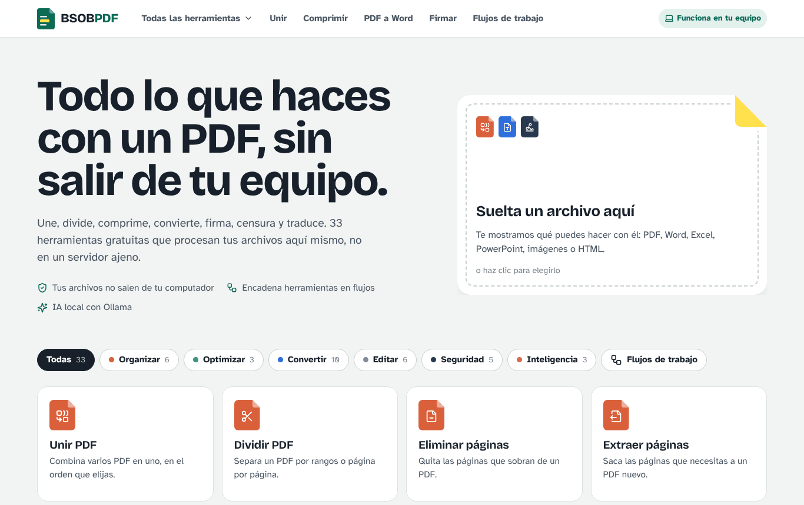

---

## Índice

1. [¿Qué es BSOBPDF?](#qué-es-bsobpdf)
2. [Las 33 herramientas](#las-33-herramientas)
3. [Capturas de pantalla](#capturas-de-pantalla)
4. [Qué necesitas para usarlo](#qué-necesitas-para-usarlo)
5. [Cómo descargarlo](#cómo-descargarlo)
6. [Cómo instalarlo y abrirlo](#cómo-instalarlo-y-abrirlo)
7. [Cómo se usa](#cómo-se-usa)
8. [Programas opcionales](#programas-opcionales)
9. [Configuración avanzada](#configuración-avanzada)
10. [Privacidad y seguridad](#privacidad-y-seguridad)
11. [Solución de problemas](#solución-de-problemas)
12. [Cómo funciona por dentro](#cómo-funciona-por-dentro)
13. [Limitaciones conocidas](#limitaciones-conocidas)
14. [Para desarrolladores](#para-desarrolladores)
15. [Licencia y créditos](#licencia-y-créditos)

---

## ¿Qué es BSOBPDF?

BSOBPDF es una aplicación web que se instala en tu computador y se usa desde el navegador, igual que una página de internet. Reúne en un solo lugar las tareas más comunes con documentos PDF: unir, dividir, comprimir, convertir a Word o Excel, firmar, censurar datos, aplicar OCR, traducir y muchas más.

La diferencia con los servicios en línea es que **tus archivos nunca salen de tu equipo**. El procesamiento ocurre en tu computador, por eso:

- **Es privado.** Sirve para documentos con datos personales, contratos, historias académicas o información institucional que no deberías subir a servidores ajenos.
- **Funciona sin internet.** Solo se necesita conexión una vez, para instalarlo. Ideal para oficinas, colegios o zonas con mala señal.
- **No tiene límites.** Sin tope de archivos por día, sin tamaño máximo artificial, sin marcas de agua ni cuentas premium.
- **Es gratis y de código abierto.** Puedes estudiarlo, modificarlo y adaptarlo.

Está inspirado en el catálogo de herramientas de iLovePDF, pero con diseño, código e identidad propios. **No está afiliado a iLovePDF ni a ninguna otra empresa.**

### Lo más destacado

- Interfaz en español, sencilla y adaptada a celular.
- Vista previa real de las páginas antes de procesar (con PDF.js).
- **Editor visual** para escribir, dibujar, insertar imágenes, resaltar y tapar contenido directamente sobre el PDF.
- **Firma** dibujada, escrita con letra manuscrita o desde una foto de tu firma en papel.
- **Escaneo con el celular**: escaneas un código QR y las fotos llegan solas al computador.
- **Flujos de trabajo**: encadena herramientas (por ejemplo unir, numerar, comprimir y proteger) y aplícalas de un clic.
- **«Continuar con»**: el resultado de una herramienta pasa directo a la siguiente sin descargarlo.
- **IA local** con [Ollama](https://ollama.com) para resumir y traducir sin enviar el documento a internet.

---

## Las 33 herramientas

### Organizar

| Herramienta | Qué hace |
|---|---|
| **Unir PDF** | Combina varios PDF en uno. Arrastras las tarjetas para elegir el orden y puede crear un marcador por archivo. |
| **Dividir PDF** | Separa un PDF por rangos personalizados, cada N páginas, página por página o eligiendo páginas con clic. |
| **Eliminar páginas** | Haces clic en las páginas que sobran y descargas el PDF sin ellas. |
| **Extraer páginas** | Saca las páginas elegidas a un PDF nuevo, o un PDF por página. |
| **Organizar PDF** | Reordena páginas arrastrándolas, gíralas, bórralas, inserta páginas en blanco y mezcla páginas de varios PDF. |
| **Escanear a PDF** | Toma fotos con la cámara del computador o del celular, detecta la hoja, la endereza y genera un PDF limpio (color, gris o blanco y negro). |

### Optimizar

| Herramienta | Qué hace |
|---|---|
| **Comprimir PDF** | Reduce el peso con tres niveles (extrema, recomendada, baja). Nunca entrega un archivo más pesado que el original. |
| **Reparar PDF** | Reconstruye PDF dañados o que no abren, recuperando todas las páginas legibles. |
| **OCR PDF** | Reconoce el texto de documentos escaneados y agrega una capa invisible para que puedas buscar, seleccionar y copiar. |

### Convertir

| Herramienta | Qué hace |
|---|---|
| **JPG a PDF** | Convierte imágenes (JPG, PNG, WEBP, BMP, TIFF, GIF) a PDF con orientación, tamaño de página y márgenes. |
| **Word a PDF** | Convierte DOC, DOCX, ODT, RTF y TXT a PDF. |
| **PowerPoint a PDF** | Convierte PPT, PPTX y ODP a PDF. |
| **Excel a PDF** | Convierte XLS, XLSX, ODS y CSV a PDF. |
| **HTML a PDF** | Guarda una página web como PDF pegando su dirección, o convierte un archivo HTML. |
| **PDF a JPG** | Convierte cada página en imagen (JPG o PNG, en tres calidades) o extrae las fotos que trae el PDF. |
| **PDF a Word** | Convierte el PDF en un DOCX editable con textos, tablas e imágenes. |
| **PDF a PowerPoint** | Una diapositiva por página, con el texto en cuadros editables (o en modo imagen idéntica). |
| **PDF a Excel** | Detecta las tablas y las pasa a Excel, con los números listos para calcular (entiende formatos como 1.250,50). |
| **PDF a PDF/A** | Convierte al estándar ISO de archivo a largo plazo (PDF/A-1b, 2b o 3b), exigido en muchos trámites. |

### Editar

| Herramienta | Qué hace |
|---|---|
| **Rotar PDF** | Gira todas las páginas o solo las que elijas, en uno o varios archivos. |
| **Números de página** | Seis posiciones, formatos como «Página 1 de 10» o texto propio, primer número, páginas a numerar, fuente, tamaño, color y modo de páginas enfrentadas. |
| **Marca de agua** | Texto o imagen, en nueve posiciones o en mosaico, con transparencia, giro y capa encima o debajo del contenido. |
| **Recortar PDF** | Dibujas el área que quieres conservar o quitas los márgenes blancos automáticamente. |
| **Editar PDF** | Agrega texto, imágenes, rectángulos, elipses, líneas, flechas, dibujo a mano, resaltado y corrector blanco. |
| **Formularios PDF** | Detecta y rellena los campos de un formulario, crea campos nuevos (texto, casilla, lista) y permite fijar las respuestas. |

### Seguridad

| Herramienta | Qué hace |
|---|---|
| **Desbloquear PDF** | Quita la contraseña y las restricciones de impresión o copia (necesitas conocer la contraseña). |
| **Proteger PDF** | Cifra con contraseña AES de 256 bits y permite bloquear impresión, copia, modificación o comentarios. |
| **Firmar PDF** | Crea tu firma e iniciales, y coloca firma, nombre, fecha o texto donde quieras; puedes repetirla en todas las páginas. |
| **Censurar PDF** | Borra para siempre áreas marcadas, palabras buscadas y datos detectados automáticamente: correos, teléfonos, cédulas, fechas, enlaces y tarjetas. |
| **Comparar PDF** | Muestra lado a lado la versión original y la nueva, con lo eliminado en rojo y lo agregado en verde, más un listado de cambios. |

### Inteligencia

| Herramienta | Qué hace |
|---|---|
| **Resumir con IA** | Resume documentos largos con un modelo local de Ollama, o sin IA eligiendo las frases más importantes. |
| **Traducir PDF** | Traduce el texto y lo coloca en el mismo lugar, conservando imágenes y diseño (Google Translate en línea u Ollama local). |
| **PDF a Markdown** | Convierte a Markdown con títulos, tablas y listas, ideal para notas, wikis o para dárselo a una IA. |

### Flujos de trabajo

Crea secuencias de herramientas, guárdalas y aplícalas a varios archivos de una vez. Incluye plantillas listas: «Listo para enviar por correo», «Documento oficial numerado», «Archivo a largo plazo» y «Borrador confidencial».

---

## Capturas de pantalla

| | |
|---|---|
| 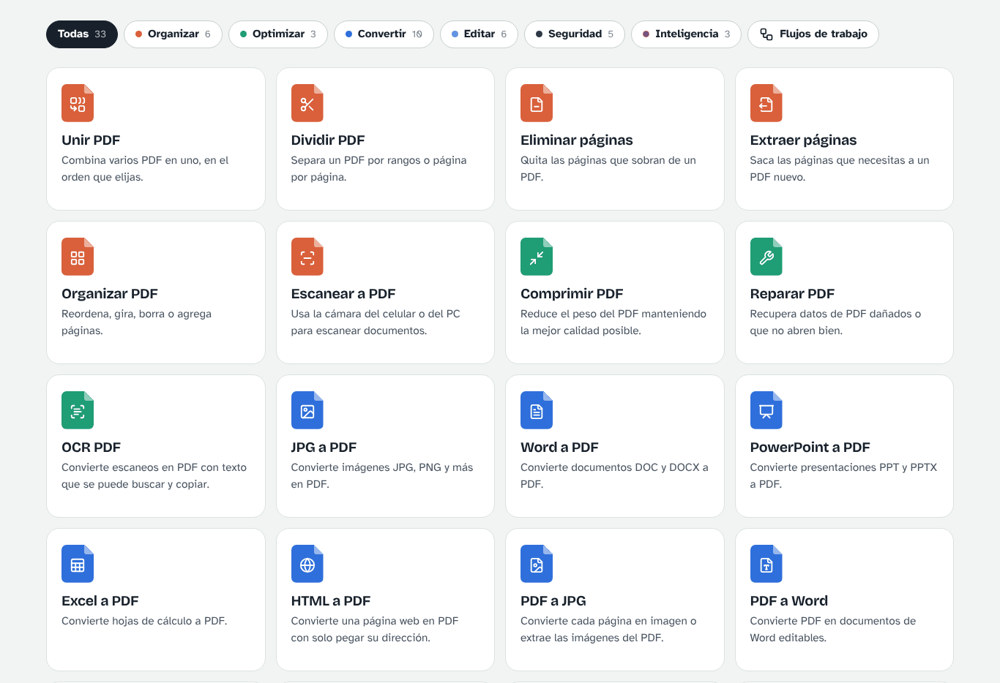 | 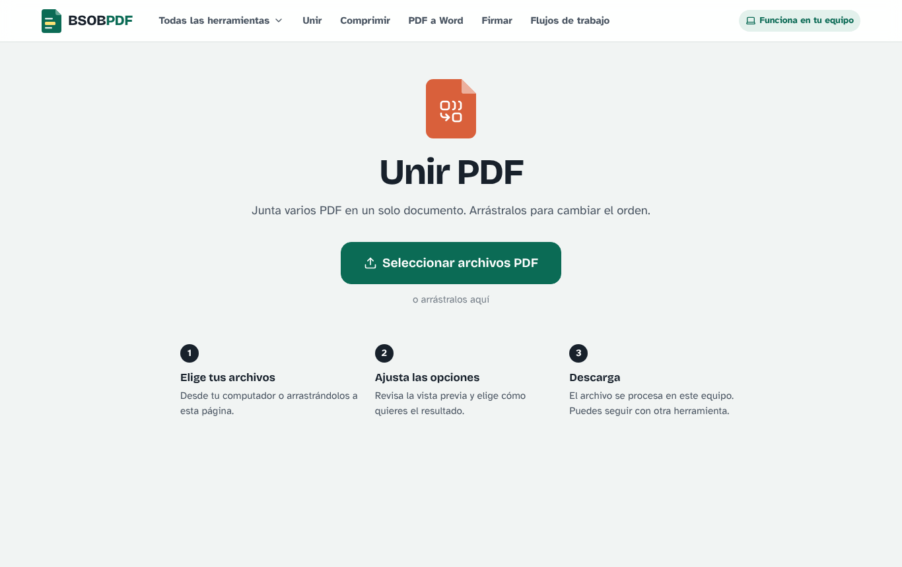 |
| Todas las herramientas, con filtros por categoría | Cada herramienta empieza igual: eliges o arrastras tus archivos |
| 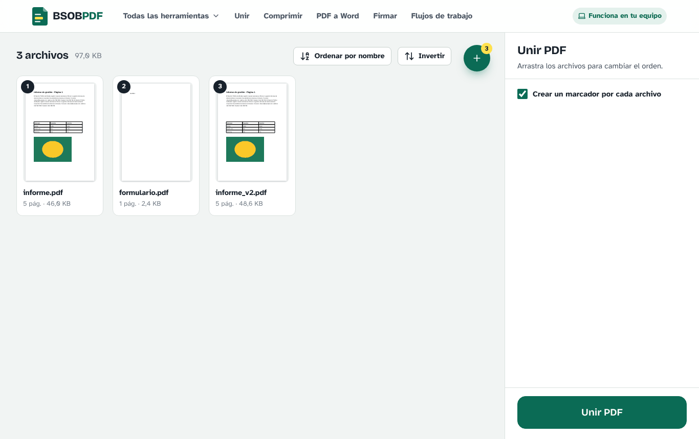 | 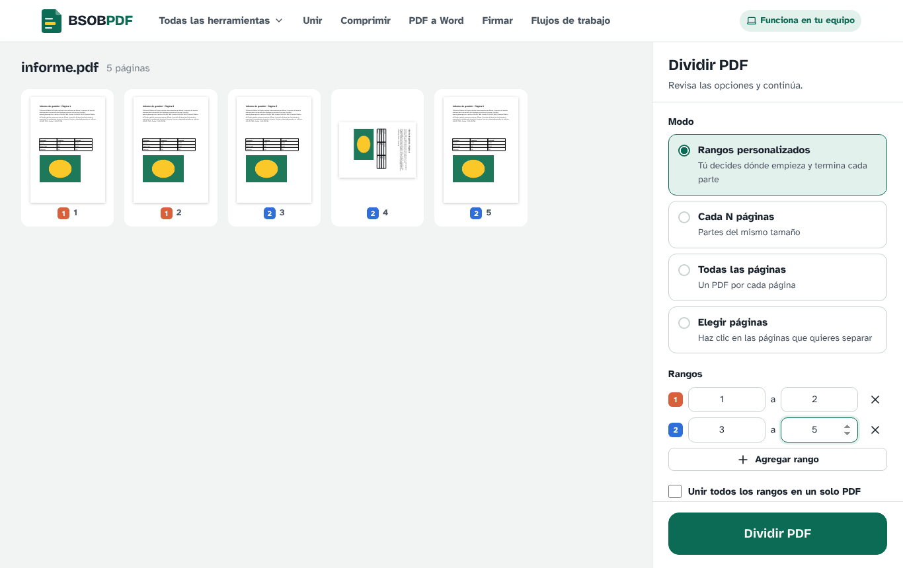 |
| Unir: arrastra las tarjetas para cambiar el orden | Dividir: cada color es un archivo de salida |
| 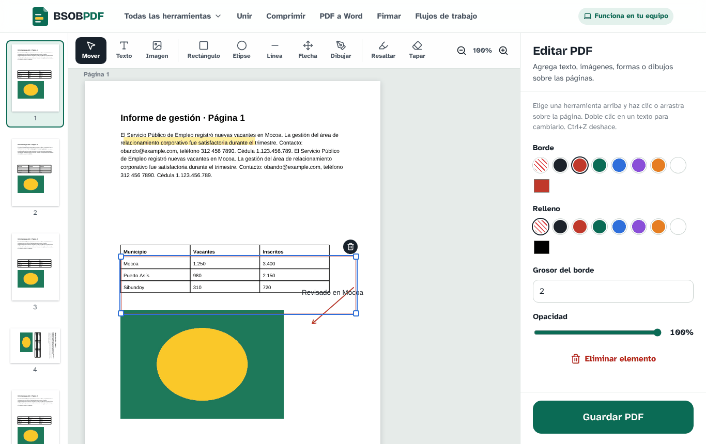 | 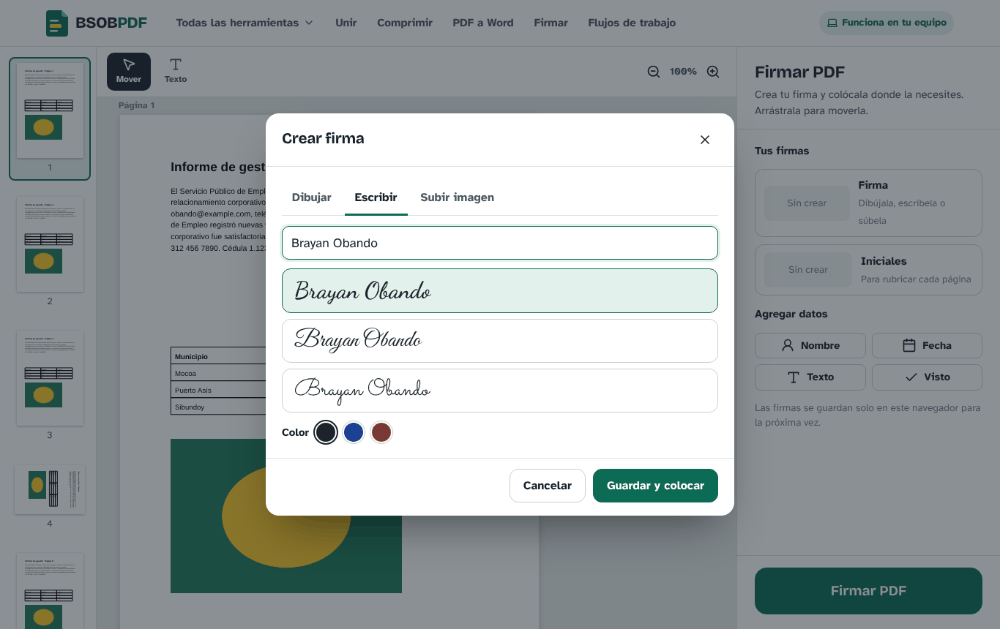 |
| Editor visual sobre las páginas | Crear firma: dibujada, escrita o desde una imagen |
| 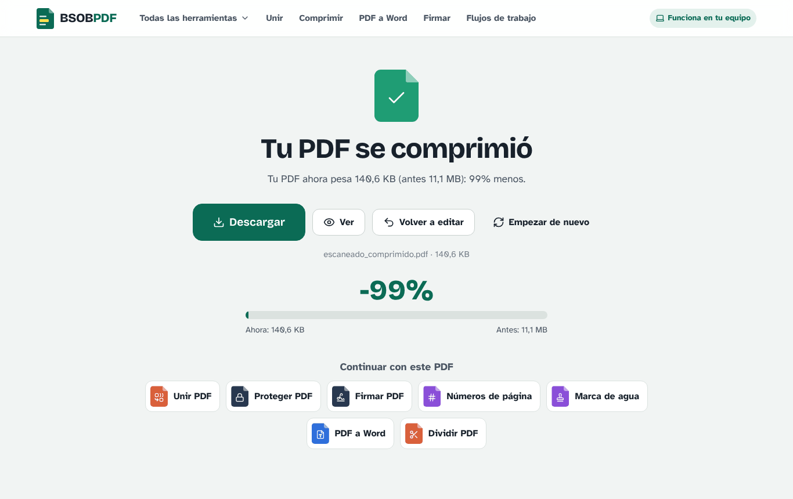 | 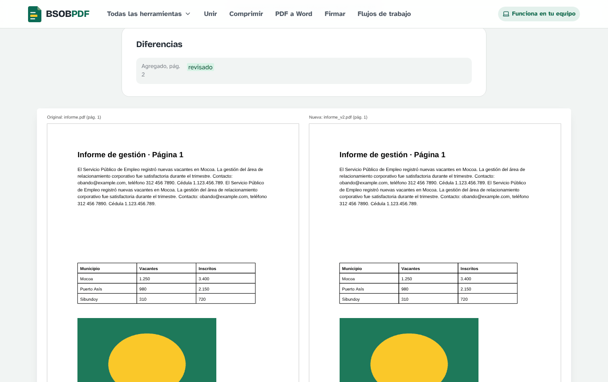 |
| Resultado: descarga y «Continuar con» otra herramienta | Comparar dos versiones lado a lado |
| 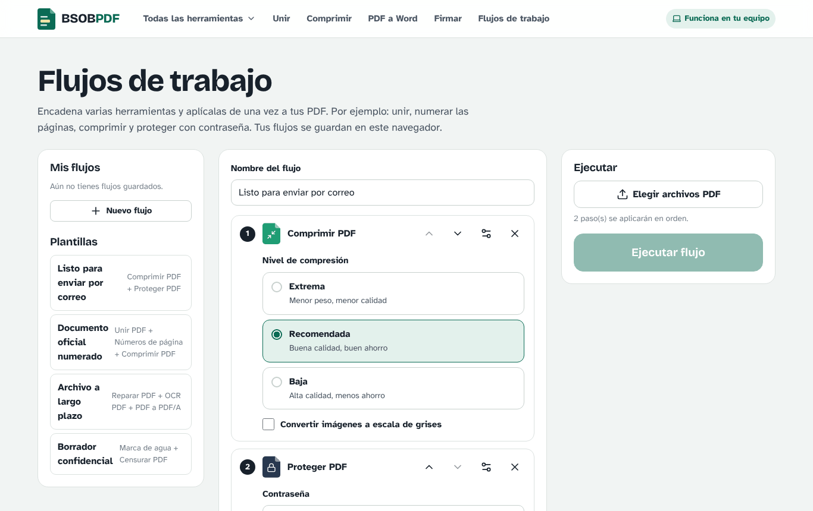 | 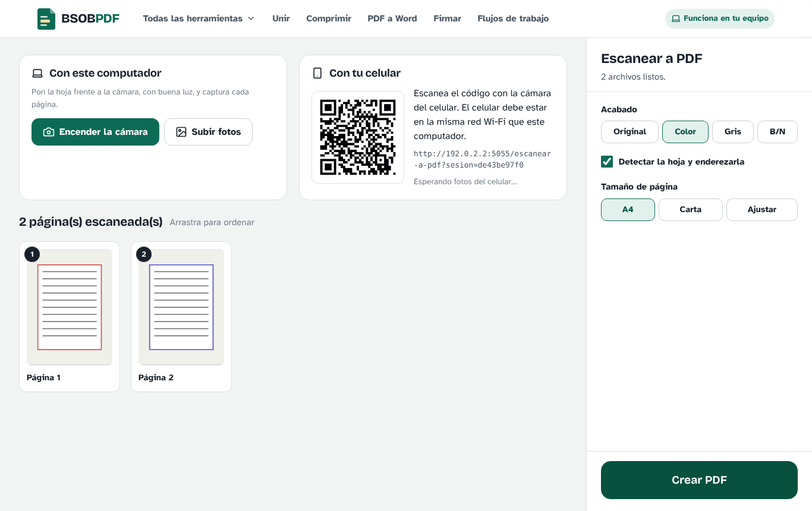 |
| Flujos de trabajo con plantillas | Escanear con la cámara del PC o del celular por QR |
| 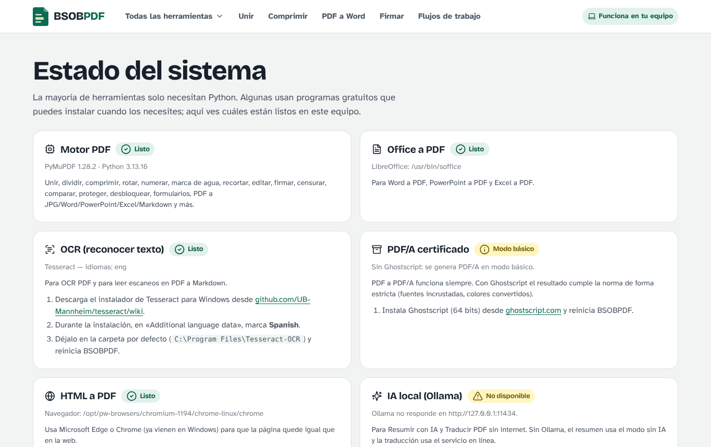 | 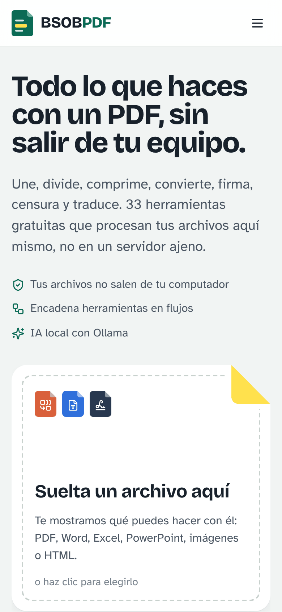 |
| Estado del sistema: qué está listo y qué falta | También se ve bien en el celular |

---

## Qué necesitas para usarlo

### Obligatorio

| Requisito | Detalle |
|---|---|
| **Sistema operativo** | Windows 10 u 11 (recomendado, tiene instalador de un clic). También funciona en Linux y macOS. |
| **Python 3.9 a 3.13** | **Solo si no usas el instalador.** Se recomienda **Python 3.12**. Descárgalo de [python.org/downloads](https://www.python.org/downloads/). |
| **Navegador** | Microsoft Edge, Google Chrome, Firefox o similar, actualizado. |
| **Espacio en disco** | Unos **500 MB** con el instalador, o **700 MB** si lo instalas desde el código. |
| **Memoria RAM** | 4 GB funcionan; 8 GB recomendados si vas a usar OCR o IA local. |
| **Internet** | Solo para descargarlo (y, sin instalador, para instalar los componentes la primera vez). Después funciona sin conexión. |

### Opcional (solo para algunas herramientas)

| Programa | Para qué herramientas | Si no lo tienes |
|---|---|---|
| [LibreOffice](https://es.libreoffice.org/descarga/) (gratis) **o** Microsoft Office | Word, PowerPoint y Excel a PDF | Esas tres herramientas avisan que falta |
| [Tesseract OCR](https://github.com/UB-Mannheim/tesseract/wiki) con idioma español | OCR PDF y leer escaneos en PDF a Markdown | El OCR avisa que falta |
| [Ghostscript](https://ghostscript.com/releases/gsdnld.html) | PDF/A con cumplimiento estricto | Se genera PDF/A en modo básico |
| Microsoft Edge o Google Chrome | HTML a PDF idéntico a la web | Se usa un conversor básico (Edge ya viene en Windows) |
| [Ollama](https://ollama.com/download) con un modelo (por ejemplo `qwen3:4b`) | Resumir y traducir sin internet | Resumen sin IA y traducción en línea |

Todas las demás herramientas (más de 25) funcionan solo con Python. Dentro de la aplicación, la página **Estado del sistema** te dice qué tienes listo y cómo instalar lo que falte.

---

## Cómo descargarlo

### Opción 1: el instalador para Windows (la más fácil)

Ve a la sección [**Releases**](https://github.com/brayanobando/BSOBPDF/releases/latest) y descarga el archivo **`BSOBPDF-Setup-x.y.z.exe`**. Es un instalador normal de Windows: no necesitas instalar Python ni nada más.

### Opción 2: el código en ZIP (Windows, Linux o macOS)

1. En esta página, haz clic en el botón verde **`<> Code`** y luego en **Download ZIP**
   (o usa este enlace directo: [descargar BSOBPDF en ZIP](https://github.com/brayanobando/BSOBPDF/archive/refs/heads/main.zip)).
2. Descomprime el ZIP en una carpeta de tu computador, por ejemplo `Documentos\BSOBPDF`.
   **Importante:** no lo ejecutes desde dentro del ZIP; primero extrae todos los archivos (clic derecho → «Extraer todo»).

### Opción 3: con Git

```bash
git clone https://github.com/brayanobando/BSOBPDF.git
cd BSOBPDF
```

Para actualizar más adelante: `git pull`.

---

## Cómo instalarlo y abrirlo

### Con el instalador de Windows (recomendado)

1. Abre **`BSOBPDF-Setup-x.y.z.exe`**.
   Como el instalador no tiene firma digital de una empresa, Windows puede mostrar «Windows protegió su PC»: pulsa **Más información → Ejecutar de todas formas**.
2. Sigue el asistente (está en español): acepta la licencia, elige si quieres un ícono en el escritorio y pulsa **Instalar**.
   Por defecto se instala solo para tu usuario y **no pide permisos de administrador**.
3. Abre **BSOBPDF** desde el menú Inicio o el escritorio. Se abre en **su propia ventana**, como cualquier programa.
4. La primera vez, si el Firewall de Windows pregunta por BSOBPDF, pulsa **Permitir** en redes privadas (solo hace falta para escanear con el celular).

**Para cerrarlo**, cierra su ventana. **Para desinstalarlo**, ve a Configuración → Aplicaciones → BSOBPDF → Desinstalar.

> El programa usa Microsoft Edge (incluido en Windows) para mostrar su ventana. Si no lo encuentra, abre BSOBPDF en tu navegador predeterminado y muestra una pequeña ventana para cerrarlo.

### Desde el código en Windows (sin instalador)

**1. Instala Python (solo la primera vez).**
Descarga Python 3.12 desde [python.org/downloads](https://www.python.org/downloads/). Al abrir el instalador, **marca la casilla «Add python.exe to PATH»** antes de pulsar «Install Now». Si ya tienes Python 3.9 o superior, salta este paso.

**2. Haz doble clic en `INICIAR.bat`.**
La primera vez:
- Si Windows muestra «Windows protegió su PC», pulsa **Más información → Ejecutar de todas formas**. Aparece porque el archivo viene de internet.
- Se crea un entorno de Python en `%LOCALAPPDATA%\BSOBPDF\venv` (fuera de tu carpeta, para no llenar OneDrive ni el proyecto).
- Se descargan e instalan los componentes. Tarda unos minutos según tu conexión.
- Si el Firewall de Windows pregunta por Python, pulsa **Permitir** en redes privadas (lo necesita el escaneo con el celular).

**3. Listo.** Se abre tu navegador en `http://127.0.0.1:5000` con BSOBPDF.

**Para cerrarlo**, cierra la ventana negra. **Para volver a abrirlo**, doble clic en `INICIAR.bat`; desde la segunda vez abre en segundos.

> Consejo: crea un acceso directo de `INICIAR.bat` en tu escritorio (clic derecho → Enviar a → Escritorio).

### En Linux

```bash
# Dependencias del sistema (Ubuntu / Debian). Los programas opcionales se pueden omitir.
sudo apt install python3 python3-venv
sudo apt install libreoffice tesseract-ocr tesseract-ocr-spa ghostscript   # opcionales

# Abrir BSOBPDF
chmod +x iniciar.sh
./iniciar.sh
```

El entorno se guarda en `~/.local/share/bsobpdf/venv`. Luego abre `http://127.0.0.1:5000`.

### En macOS

```bash
brew install python@3.12
brew install --cask libreoffice          # opcional
brew install tesseract tesseract-lang ghostscript   # opcionales
chmod +x iniciar.sh
./iniciar.sh
```

### Instalación manual (cualquier sistema)

Si prefieres hacerlo a mano:

```bash
python -m venv .venv
# Windows:      .venv\Scripts\activate
# Linux/macOS:  source .venv/bin/activate
pip install -r requirements.txt
python app.py
```

---

## Cómo se usa

### El recorrido de cualquier herramienta

1. **Elige la herramienta** en la página principal. Puedes filtrar por categoría o usar el menú «Todas las herramientas».
2. **Sube tus archivos** con el botón grande o arrastrándolos a la página.
3. **Revisa y ajusta.** A la izquierda ves la vista previa de los archivos o páginas; a la derecha, las opciones.
4. **Pulsa el botón verde** (Unir PDF, Comprimir PDF, etc.). Verás el progreso mientras se procesa.
5. **Descarga** el resultado. Si son varios archivos, llegan en un ZIP.

En la pantalla final también puedes **Ver** el PDF, **Volver a editar** con las mismas opciones o **Continuar con** otra herramienta usando el resultado.

> **Atajo:** en la página principal, suelta un archivo en la hoja de la derecha y BSOBPDF te muestra qué herramientas sirven para él.

### Consejos por herramienta

**Unir PDF.** Arrastra las tarjetas para ordenarlas, o usa «Ordenar por nombre» e «Invertir». El botón verde con el signo + agrega más archivos.

**Dividir PDF.** Cada página muestra una etiqueta de color que indica a qué archivo de salida irá. En «Elegir páginas», haz clic sobre las páginas o escribe rangos como `1-3, 5, 8-10`.

**Eliminar y extraer páginas.** Haz clic en las miniaturas; el cuadro de páginas se actualiza solo. También puedes escribir `impares`, `pares` o `todas`.

**Organizar PDF.** Arrastra las páginas para ordenarlas. Al pasar el cursor sobre una página aparecen los botones para girarla, insertar una página en blanco después o eliminarla. Si agregas otro PDF, sus páginas se marcan con otra letra (A, B, C…).

**Rotar PDF.** Clic en una página la gira 90°; los botones del panel giran todo el documento.

**Comprimir PDF.** «Recomendada» es el equilibrio entre peso y calidad. «Extrema» es para cuando necesitas el archivo más liviano posible (por ejemplo para subirlo a una plataforma con límite). Al terminar ves cuánto se redujo.

**OCR PDF.** Elige el idioma del documento (por defecto español + inglés). El resultado se ve igual, pero ahora puedes buscar con Ctrl+F y copiar el texto. Las páginas que ya tienen texto se saltan.

**Editar PDF.** Elige una herramienta en la barra superior:
- **Texto:** haz clic donde quieras escribir. Doble clic en un texto para cambiarlo.
- **Rectángulo, elipse, resaltar, tapar:** arrastra sobre la página.
- **Línea y flecha:** arrastra del inicio al final.
- **Dibujar:** mantén presionado y dibuja.
- **Imagen:** elige un archivo y se coloca en la página visible.
- Selecciona un elemento para cambiar color, tamaño, grosor u opacidad en el panel derecho.
- **Atajos:** `Supr` elimina, `Ctrl+Z` deshace, las flechas mueven 1 punto (`Shift` + flecha, 10 puntos), `Esc` deselecciona. Arrastrar una esquina de un texto cambia el tamaño de la letra.

**Firmar PDF.** Pulsa «Firma» para crearla:
- **Dibujar** con el mouse, el dedo o un lápiz digital.
- **Escribir** tu nombre y elegir entre tres estilos de letra manuscrita.
- **Subir** una foto de tu firma en papel; la opción «Quitar el fondo blanco» la deja transparente.

La firma se guarda en tu navegador para la próxima vez. Después arrástrala a su lugar y ajusta el tamaño desde la esquina. «Repetir en todas las páginas» es útil para rubricar con las iniciales. Los botones «Nombre», «Fecha», «Texto» y «Visto» agregan esos datos rápidamente.

**Censurar PDF.** Combina tres formas: dibujar rectángulos sobre lo que quieras tapar, escribir palabras o frases (una por línea) y marcar los datos a detectar (correos, teléfonos, cédulas, fechas, enlaces, tarjetas). La censura es **permanente**: el texto debajo se elimina del archivo, no solo se tapa. También borra los metadatos (autor, título) si dejas marcada esa opción.

**Recortar PDF.** Mueve el recuadro y sus esquinas; lo oscuro se elimina. Puedes aplicarlo a todas las páginas o solo a la visible, o activar «Quitar márgenes blancos automáticamente».

**Formularios PDF.** Si el PDF ya tiene campos, aparecen como casillas sobre el documento: escribe directamente en ellas. Para crear campos nuevos, elige «Campo de texto», «Casilla» o «Lista» y arrastra sobre la página. «Fijar respuestas» convierte los campos en texto normal que ya no se puede editar.

**Comparar PDF.** El primer archivo es el original y el segundo la versión nueva (el botón «Intercambiar» los invierte). Obtienes un PDF con ambas versiones lado a lado y la lista de cambios.

**PDF a Word, PowerPoint y Excel.** Funcionan mejor con PDF que tienen texto real. Si el PDF es un escaneo, aplica primero **OCR PDF** (usa «Continuar con»).

**Traducir PDF.** Elige el idioma de destino y el motor: «En línea» (Google Translate, necesita internet) o «IA local» (Ollama, sin internet). El texto traducido ocupa el lugar del original y se ajusta al espacio disponible.

**Resumir con IA.** Con Ollama abierto, elige el modelo, la extensión y el idioma del resumen. Sin Ollama, usa el motor «Sin IA». Puedes copiar el resumen o descargarlo en PDF y Markdown.

### Escanear con el celular

1. Abre **Escanear a PDF** en el computador.
2. Con la cámara del celular, escanea el código QR que aparece. El celular debe estar **conectado a la misma red Wi‑Fi** que el computador.
3. En el celular, pulsa **Tomar foto** para cada página.
4. Las fotos aparecen solas en el computador. Ordénalas, elige el acabado (color, gris o B/N) y pulsa **Crear PDF**.

Si prefieres, también puedes crear el PDF directamente en el celular con «Crear el PDF en este celular». Desde el computador también puedes usar su cámara web («Encender la cámara») o subir fotos.

### Flujos de trabajo

1. Abre **Flujos de trabajo** en el menú superior.
2. Elige una plantilla o pulsa **Nuevo flujo**.
3. Agrega pasos con los botones de «Agregar un paso» y ajusta las opciones de cada uno (el ícono de engranaje las muestra u oculta). Las flechas cambian el orden.
4. Ponle nombre y pulsa **Guardar flujo** para reutilizarlo.
5. En «Ejecutar», elige tus PDF y pulsa **Ejecutar flujo**. Al final ves el registro de lo que hizo cada paso.

Herramientas que se pueden encadenar: unir, eliminar y extraer páginas, comprimir, reparar, OCR, PDF/A, rotar, números de página, marca de agua (texto), recortar (márgenes automáticos), censurar (palabras y datos detectados), desbloquear, proteger y traducir. «Unir» siempre va de primero y solo actúa si cargas varios archivos.

---

## Programas opcionales

### LibreOffice (Word, PowerPoint y Excel a PDF)

- **Windows:** descarga desde [es.libreoffice.org/descarga](https://es.libreoffice.org/descarga/) e instala con las opciones por defecto. Si ya tienes **Microsoft Office**, BSOBPDF lo usa automáticamente y no necesitas LibreOffice.
- **Linux:** `sudo apt install libreoffice`
- **macOS:** `brew install --cask libreoffice`

### Tesseract (OCR)

- **Windows:** descarga el instalador desde [github.com/UB-Mannheim/tesseract/wiki](https://github.com/UB-Mannheim/tesseract/wiki). Durante la instalación, en **«Additional language data»**, marca **Spanish**. Déjalo en la carpeta por defecto (`C:\Program Files\Tesseract-OCR`).
- **Linux:** `sudo apt install tesseract-ocr tesseract-ocr-spa`
- **macOS:** `brew install tesseract tesseract-lang`

### Ghostscript (PDF/A estricto)

- **Windows:** instala la versión de 64 bits desde [ghostscript.com](https://ghostscript.com/releases/gsdnld.html).
- **Linux:** `sudo apt install ghostscript` · **macOS:** `brew install ghostscript`

### Ollama (IA local para resumir y traducir)

1. Instala Ollama desde [ollama.com/download](https://ollama.com/download).
2. Descarga un modelo en una terminal: `ollama pull qwen3:4b` (si tu equipo tiene poca memoria, `ollama pull qwen2.5:3b`).
3. Deja Ollama abierto. BSOBPDF detecta los modelos y te deja elegir.

Después de instalar cualquiera de estos programas, **cierra y vuelve a abrir BSOBPDF**.

---

## Configuración avanzada

BSOBPDF se configura con variables de entorno. En Windows puedes agregarlas al principio de `INICIAR.bat` (debajo de `cd /d "%~dp0"`), por ejemplo `set BSOBPDF_PORT=8080`.

| Variable | Para qué sirve | Valor por defecto |
|---|---|---|
| `BSOBPDF_PORT` | Puerto del servidor | `5000` (si está ocupado, usa el siguiente libre) |
| `BSOBPDF_HOST` | `127.0.0.1` para que solo este equipo pueda entrar | `0.0.0.0` (accesible en tu red local) |
| `BSOBPDF_MAX_MB` | Tamaño máximo total de subida, en MB | `500` |
| `BSOBPDF_TMP` | Carpeta de archivos temporales | Carpeta temporal del sistema + `bsobpdf` |
| `BSOBPDF_MAX_AGE` | Segundos antes de borrar los archivos temporales | `10800` (3 horas) |
| `BSOBPDF_NO_BROWSER` | `1` para no abrir el navegador al iniciar | (vacío) |
| `BSOBPDF_OLLAMA_URL` | Dirección de Ollama | `http://127.0.0.1:11434` |
| `BSOBPDF_OLLAMA_MODEL` | Modelo de Ollama preferido | Automático |
| `BSOBPDF_OFFICE_ENGINE` | `lo` para preferir LibreOffice sobre Microsoft Office | `auto` |
| `BSOBPDF_SOFFICE` | Ruta a `soffice` si LibreOffice está en otra carpeta | Automático |
| `BSOBPDF_TESSDATA` | Carpeta `tessdata` de Tesseract | Automático |
| `BSOBPDF_BROWSER` | Ruta a Edge o Chrome para HTML a PDF | Automático |

---

## Privacidad y seguridad

- **Tus documentos se procesan en tu computador.** Cada proceso usa una carpeta temporal propia que se borra sola a las 3 horas.
- **Lo único que usa internet** es la traducción con el motor «En línea» (envía el texto a Google Translate) y la herramienta HTML a PDF cuando le das una dirección web. Todo lo demás funciona sin conexión.
- **Las firmas** se guardan solo en el almacenamiento de tu navegador, en tu equipo.
- **En tu red local:** por defecto, otros dispositivos de tu misma red Wi‑Fi pueden abrir BSOBPDF (así funciona el escaneo con el celular). Si no lo quieres, usa `BSOBPDF_HOST=127.0.0.1`.
- **No está pensado para publicarse en internet tal cual.** No tiene usuarios ni contraseñas, ni límites por persona. Para ofrecerlo como servicio público hay que agregar protecciones (límites de tamaño y de uso, bloquear direcciones internas en HTML a PDF, HTTPS, cola de trabajos).
- **Firma:** la herramienta Firmar PDF coloca tu firma como imagen (firma electrónica simple). **No es una firma digital certificada** con certificado de una entidad acreditada.

---

## Solución de problemas

<details>
<summary><b>Windows dice «Windows protegió su PC» o el antivirus bloquea el instalador</b></summary>

El instalador es de código abierto pero no está firmado con un certificado comercial, por eso SmartScreen avisa. Pulsa **Más información → Ejecutar de todas formas**. Si tu antivirus lo bloquea, puedes revisar que el archivo venga de la página oficial de [Releases](https://github.com/brayanobando/BSOBPDF/releases) o instalar desde el código con `INICIAR.bat`.
</details>

<details>
<summary><b>El programa instalado no abre</b></summary>

Revisa el registro en `%LOCALAPPDATA%\BSOBPDF\bsobpdf.log`. Si el problema continúa, desinstálalo, vuelve a instalarlo y abre un [issue](https://github.com/brayanobando/BSOBPDF/issues) con el contenido de ese archivo.
</details>

<details>
<summary><b>«No se encontró Python» al abrir INICIAR.bat</b></summary>

Instala Python desde [python.org](https://www.python.org/downloads/) marcando **«Add python.exe to PATH»**. Si ya lo instalaste sin esa casilla, ejecuta de nuevo el instalador, elige «Modify» y activa «Add Python to environment variables». Si Windows abre la Microsoft Store al escribir `python`, desactiva los alias en Configuración → Aplicaciones → Configuración avanzada de aplicaciones → Alias de ejecución de aplicaciones.
</details>

<details>
<summary><b>La instalación de componentes falla</b></summary>

- Revisa tu conexión a internet y vuelve a ejecutar `INICIAR.bat`.
- Si usas una versión de Python muy nueva y algún componente no tiene versión para ella, instala **Python 3.12**.
- Borra la carpeta `%LOCALAPPDATA%\BSOBPDF\venv` y vuelve a ejecutar `INICIAR.bat` para empezar limpio.
</details>

<details>
<summary><b>El navegador no se abre solo</b></summary>

Abre tú mismo la dirección que aparece en la ventana negra, normalmente `http://127.0.0.1:5000`. Si el puerto 5000 estaba ocupado, BSOBPDF usa el siguiente libre (5001, 5002…) y lo muestra en la ventana.
</details>

<details>
<summary><b>Word, PowerPoint o Excel a PDF dicen que falta un programa</b></summary>

Instala [LibreOffice](https://es.libreoffice.org/descarga/) (gratis) o Microsoft Office y reinicia BSOBPDF. Revisa la página **Estado del sistema**.
</details>

<details>
<summary><b>El OCR no reconoce bien el español</b></summary>

Reinstala Tesseract marcando el idioma **Spanish** en «Additional language data». En Estado del sistema debe aparecer `spa` entre los idiomas.
</details>

<details>
<summary><b>El celular no abre la página del código QR</b></summary>

- El celular y el computador deben estar en la **misma red Wi‑Fi** (no datos móviles).
- Permite Python en el Firewall de Windows para redes privadas: Panel de control → Firewall de Windows Defender → Permitir una aplicación.
- Algunas redes públicas o institucionales bloquean la comunicación entre equipos; en ese caso usa «Subir fotos» en el computador.
</details>

<details>
<summary><b>La cámara del computador no enciende</b></summary>

Acepta el permiso de cámara que pide el navegador y cierra otras aplicaciones que la estén usando (Zoom, Meet, Teams). El navegador solo permite la cámara cuando abres BSOBPDF como `127.0.0.1` o `localhost`.
</details>

<details>
<summary><b>La traducción falla</b></summary>

El motor «En línea» necesita internet y Google limita la cantidad de solicitudes; espera un momento y reintenta, o usa el motor «IA local» con Ollama.
</details>

<details>
<summary><b>«Este PDF está protegido con contraseña»</b></summary>

Usa primero **Desbloquear PDF** con la contraseña y luego «Continuar con» la herramienta que necesitabas.
</details>

<details>
<summary><b>Un PDF escaneado no se convierte bien a Word o Excel</b></summary>

Los escaneos son imágenes, no texto. Aplica primero **OCR PDF** y después convierte.
</details>

---

## Cómo funciona por dentro

BSOBPDF es una aplicación web local: un pequeño servidor en Python atiende al navegador del mismo computador.

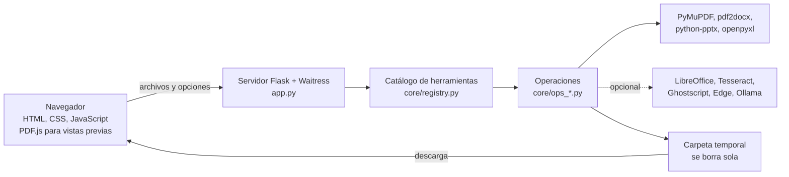

| Capa | Tecnología |
|---|---|
| Interfaz | HTML, CSS y JavaScript sin frameworks; [PDF.js](https://mozilla.github.io/pdf.js/) para las miniaturas y el editor; iconos [Lucide](https://lucide.dev) |
| Servidor | [Flask](https://flask.palletsprojects.com) servido con [Waitress](https://docs.pylonsproject.org/projects/waitress/) |
| Motor PDF | [PyMuPDF](https://pymupdf.readthedocs.io) (MuPDF) para casi todas las operaciones |
| Conversiones | [pdf2docx](https://github.com/ArtifexSoftware/pdf2docx), [python-pptx](https://python-pptx.readthedocs.io), [openpyxl](https://openpyxl.readthedocs.io), [PyMuPDF4LLM](https://pymupdf.readthedocs.io/en/latest/pymupdf4llm/), Pillow y OpenCV |
| Motores externos | LibreOffice o Microsoft Office, Tesseract, Ghostscript, Edge o Chrome con Playwright, Ollama |

### Estructura del proyecto

```
BSOBPDF/
├── INICIAR.bat             Arranque desde el código en Windows (doble clic)
├── iniciar.sh              Lo mismo para Linux y macOS
├── app.py                  Servidor web: páginas, API y descargas
├── escritorio.py           Versión de escritorio: ventana propia, sin consola (la usa el instalador)
├── requirements.txt        Componentes de Python
├── core/
│   ├── registry.py         Catálogo: nombre, textos, archivos aceptados, opciones y función de cada herramienta
│   ├── ops_organize.py     Unir, dividir, eliminar, extraer, organizar, escanear
│   ├── ops_optimize.py     Comprimir, reparar, OCR
│   ├── ops_convert.py      Conversiones a y desde PDF, PDF/A, Markdown
│   ├── ops_edit.py         Rotar, numerar, marca de agua, recortar, editor, firma, formularios
│   ├── ops_security.py     Desbloquear, proteger, censurar, comparar
│   ├── ops_ai.py           Resumir y traducir
│   ├── workflow.py         Flujos de trabajo
│   ├── engines.py          Detección de LibreOffice, Office, Tesseract, Ghostscript, navegador y Ollama
│   ├── jobs.py             Carpetas temporales que se borran solas
│   └── utils.py            Utilidades comunes (rangos de páginas, nombres, errores)
├── templates/              Páginas HTML (Jinja2)
├── static/
│   ├── css/styles.css      Estilos
│   ├── js/                 core, options, tool, editor, scan, workflows, index
│   ├── fonts/              Tipografías incluidas (funciona sin internet)
│   ├── icons/              Iconos Lucide
│   └── vendor/pdfjs/       PDF.js
├── empaquetado/            Receta de PyInstaller, ícono e instalador de Inno Setup
├── .github/workflows/      Compilación automática del instalador en Windows
├── tests/                  Pruebas automáticas (pytest)
└── docs/                   Guía para desarrolladores y capturas
```

---

## Limitaciones conocidas

- **PDF a Word y a PowerPoint:** los diseños muy complejos (columnas, fondos, fuentes especiales) pueden no quedar idénticos.
- **Traducir PDF:** el texto se reescribe con fuentes estándar y se ajusta al espacio; los idiomas con alfabetos no latinos pueden necesitar ajustes. Los escaneos requieren OCR antes.
- **OCR:** funciona mejor con páginas derechas y bien iluminadas.
- **PDF/A:** sin Ghostscript se genera en modo básico, que puede no pasar un validador estricto.
- **HTML a PDF:** no convierte páginas que requieren iniciar sesión.
- **Firma:** es una firma electrónica simple (imagen), no una firma digital con certificado.
- **Procesa un trabajo a la vez**, suficiente para uso personal o de oficina.

## Ideas para próximas versiones

- Firma digital con certificado (.p12 / .pfx).
- Imagen de Docker para instalar en servidores.
- Instalador firmado digitalmente para evitar el aviso de SmartScreen.
- Modo oscuro.
- Interfaz en otros idiomas.
- Cola de trabajos para varios usuarios simultáneos.

---

## Para desarrolladores

En [**docs/DESARROLLO.md**](docs/DESARROLLO.md) encontrarás la arquitectura en detalle, la referencia de la API, cómo agregar una herramienta nueva en pocas líneas y cómo ejecutar las pruebas:

```bash
pip install -r requirements.txt pytest
pytest -q
```

¿Encontraste un error o tienes una idea? Abre un [issue](../../issues) o envía un pull request.

---

## Licencia y créditos

BSOBPDF se distribuye bajo la licencia **GNU AGPL-3.0** (ver [LICENSE](LICENSE)). En pocas palabras: puedes usarlo, copiarlo, estudiarlo y modificarlo libremente; si distribuyes una versión modificada **u ofreces una versión modificada como servicio en internet**, debes compartir su código fuente bajo la misma licencia. Se eligió esta licencia porque PyMuPDF, el motor principal, también es AGPL-3.0.

Componentes de terceros:

| Componente | Licencia |
|---|---|
| [PyMuPDF](https://github.com/pymupdf/PyMuPDF) y PyMuPDF4LLM | AGPL-3.0 (o licencia comercial de Artifex) |
| [pdf2docx](https://github.com/ArtifexSoftware/pdf2docx) | MIT |
| [PDF.js](https://github.com/mozilla/pdf.js) (incluido en `static/vendor`) | Apache 2.0 |
| [Lucide](https://lucide.dev) (iconos incluidos) | ISC |
| Bricolage Grotesque, Atkinson Hyperlegible, Dancing Script, Great Vibes y Sacramento (tipografías incluidas) | SIL Open Font License 1.1 |
| Flask, qrcode | BSD |
| python-pptx, openpyxl, deep-translator | MIT |
| Pillow | MIT-CMU |
| requests, Playwright | Apache 2.0 |
| Waitress | ZPL 2.1 |

**iLovePDF** es una marca de su respectivo dueño; BSOBPDF solo se inspira en su catálogo de funciones y no tiene relación con esa empresa.

---

<p align="center">
  Hecho por <a href="https://github.com/brayanobando">Brayan Stiven Obando</a>.<br>
  Si te sirvió, deja una ⭐ en el repositorio.
</p>
